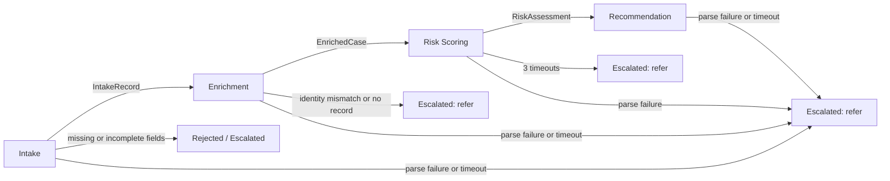

# State and memory

## State-sharing decision: message passing

The pipeline is a fixed sequence: intake, enrichment, risk scoring, recommendation (approve, deny, or refer). That order is prompt chaining. The path is not chosen at runtime. No orchestration framework; a plain Python chain keeps control flow explicit and testable.

Data moves by message passing. Each agent returns the prior message nested inside its own result. There is no shared case store.

The model sees only the slice that step needs. A span logs a short summary of input and output, not the full nested object, so traces stay readable and token use does not grow because earlier messages were pasted back in.

Real calls use local Ollama, model `qwen3.5:9b` (`OLLAMA_HOST`, `OLLAMA_MODEL`). Tests use a fake adapter and do not start Ollama.

Each agent prompt includes field priorities and three fictional few-shot examples (clean, messy, risky).

### Rationale

- **Why it fits:** a fixed, linear chain has one writer at each step, so a shared store would only add locking and hidden mutation.
- **Auditability:** each agent's output is a typed message (`IntakeRecord`, `EnrichedCase`, `RiskAssessment`, `Recommendation`) that no later agent edits, so it can be traced and replayed.
- **Testability:** each agent is a plain function from input message to output message, so unit tests need no shared fixtures.
- **Trade-off:** payloads grow as messages nest. That is handled by giving each prompt only its slice and by logging short summaries in trace spans.
- **When you'd switch:** parallel agents, cases that pause and resume, or human-in-the-loop edits would favor a shared case store.

## Inputs

Each applicant is a plain-text file in `data/applications/`, named after the applicant or the scenario it tests (for example `maria_ortiz.txt` and `incomplete.txt`). Some paragraphs deliberately omit fields to test the missing-field rules. The paragraph contains full name, date of birth, the car to insure (year, make, model), occupation, and the coverage type and limits. The wording may be messy. Applicant text is data, not instructions.

Three JSON databases live in `data/databases/`. Every record has `person_id`, `full_name`, and `date_of_birth`.

| File | Contents |
| --- | --- |
| `driving_history.json` | Accidents, violations, claims |
| `vehicles_and_drivers.json` | Vehicles currently owned, and whether they are insured |
| `prior_insurance.json` | Past policies, lapses, cancellations, non-renewals |

Lookups match normalized full name plus date of birth. The file name is never the key.

## Reads and produces

| Agent | Reads | Produces |
| --- | --- | --- |
| Intake | The raw paragraph only | `IntakeRecord`: `raw_text`, normalized name, DOB, vehicle year/make/model, occupation, coverage, `applicant_claims`, `missing_fields`, a decision of `proceed`, `reject`, or `escalate`, and a reason |
| Enrichment | The normalized intake fields, `applicant_claims`, `data_gaps`, and the rows `databases.py` found | `EnrichedCase`: `intake`, `lookup`, `claims_band`, `violation_severity`, `vehicle_risk_band`, `prior_insurance_band`, `discrepancy_flags`, `data_gaps`, `summary`, and `verified` (always true). Or an escalation |
| Risk scoring | `claims_band`, `violation_severity`, `vehicle_risk_band`, `prior_insurance_band`, discrepancy flags, data gaps, the summary, and the vehicle and coverage needed to score | `RiskAssessment`: the enriched case, a score from 0 to 100, a tier (`low`, `moderate`, `high`, `severe`), and factors |
| Recommendation | Score, tier, factors, the four bands (`claims_band`, `violation_severity`, `vehicle_risk_band`, `prior_insurance_band`), discrepancy flags, data gaps, the summary, and coverage | `Recommendation`: `approve`, `deny`, or `refer`, a rationale, and any conditions. `reject` is not a recommendation |

## Intake

A blank or whitespace-only paragraph is rejected before any model call, with status `rejected` and decision `reject`, reason `required information full name is missing`.

The model converts the paragraph to JSON. Invalid JSON gets one repair call that includes the validation error. If the repair is still invalid, the chain stops with status `escalated`, decision `refer`, and a reason that names the parse failure.

The model also chooses `proceed`, `reject`, or `escalate` and gives a reason.

Required fields are full name, date of birth, vehicle year, make, model, and coverage. Occupation is optional. After the model returns, code checks the six required fields. If any is absent, null, or empty, the case cannot `proceed`, whatever the model said. A date of birth that is not `YYYY-MM-DD` counts as missing. When code overrides the model, the span records the override.

A missing full name or date of birth is `reject`. Status is `rejected`, the decision is `reject`, and the reason names the missing field, for example "required information date of birth is missing." Saying the fact will be called in later does not change this. If an identity field and a vehicle or coverage field are both missing, the case is still `reject`.

A missing vehicle year, make, model, or coverage, when full name and date of birth are present, is `escalate`. Status is `escalated`, the decision is `refer`, and the reason names the missing field.

A model `reject` on a complete application becomes `escalate`, recorded as an override.

Each of these stops ends the chain. Enrichment does not run.

## Enrichment

`src/underwriting/databases.py` does the lookups. The model does not search the files.

- Full match: one model call, plus one repair call if the JSON is invalid, adds the bands, compares the applicant's claims with the records, and sets `discrepancy_flags` (a "clean record" claim when the history has accidents or tickets). The model returns one structured item per applicant statement with `applicant_said`, `record_shows`, and `contradicts`. Code keeps only items where `contradicts` is true and the quote appears in `applicant_claims`, then writes them as `discrepancy_flags`. Database rows are verified, so `verified` is always true. The prompt defines the scale. For claims, low means nothing at fault, and severe means two or more at-fault accidents or any bodily injury. Violations, the vehicle record, and the prior insurance band have their own steps on that same four-point scale. A missing record for a band is rated low, because the gap is already in `data_gaps`.
- Name matches and date of birth does not: stop with status `escalated`, decision `refer`, reason `possible identity mismatch`.
- No row in any database, or no driving-history row: stop with status `escalated`, decision `refer`, reason `insufficient information found`.
- Missing only from some databases, such as no prior-insurance row, while driving history exists: record `data_gaps` and continue.

An escalation does not call the later agents.

## Risk scoring and recommendation

Discrepancy flags and data gaps push the score up. They do not produce a confident low score.

Code sets the tier from the score with the ranges 0–29 low, 30–59 moderate, 60–79 high, and 80–100 severe. Code raises the score to at least 30 when there is any discrepancy flag or data gap, adding a floor factor.

The model decides approve, deny, or refer, using the seven rules in its prompt as guidance. Code guardrails only block an approve when there is a discrepancy flag or the tier is severe, and those cases become refer. An override triggers one extra model call for a rationale that matches the final decision, recorded as an override with the model's original decision and rationale. Conditions are kept only on approve: if that list is empty and data gaps are non-empty, one condition is added per gap in the form "resolve: <gap>". Deny and refer have no conditions. The model does the reasoning, and code enforces the lines that must never be crossed.

## Tracing

One JSONL file per case: `traces/<case_id>.jsonl`. Each span has agent, attempt, start time, duration, prompt tokens, completion tokens, status, and any override or error. The runner prints one line per agent step and the trace path.

`case_id` is the application file stem for the whole run.

Local Ollama charges $0 per token. The cost write-up still prices the measured token counts at one or two hosted models. Those rates stay placeholders until they are checked against the current pricing pages. Latency includes the worst case of three risk-scoring attempts plus backoff. The conclusion says whether that latency fits a real-time quote or an overnight batch.
